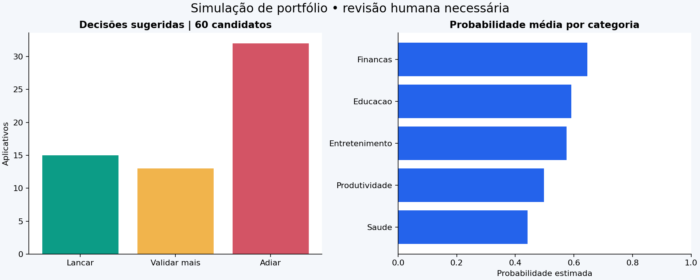

# LaunchLens

**Ciência de dados para apoiar decisões de lançamento de aplicativos.**

Estudo reproduzível em Python e Jupyter, com dados sintéticos, classificação probabilística,
política de decisão e relatório Power BI em formato **PBIP/PBIR**.

> Base 100% fictícia. O modelo aprende hipóteses do simulador e não comprova viabilidade comercial real.
> A saída apoia revisão humana: `Lancar`, `Validar mais` ou `Adiar`.



## Problema e critério de sucesso

Antes de lançar um aplicativo, a equipe reúne sinais de demanda, concorrência, resultados de beta,
preço, custos e experiência. O modelo estima a probabilidade de **ROI observado em 12 meses >=20%**.
Os custos e a receita observados no futuro definem o alvo, mas **não entram no treinamento**.

A decisão usa a probabilidade e cortes definidos na validação. `Lancar` significa avançar para aprovação
humana, não uma garantia de sucesso. O modelo não prevê receita ou lucro em reais.

## Entregas implementadas

- 5.000 aplicativos históricos simulados e 60 candidatos sem desfechos.
- Gerador determinístico, dicionário de dados, validação de domínio e rastreabilidade por SHA-256.
- Comparação de baseline, regressão logística e gradient boosting com calibração.
- Separação temporal com intervalos de maturação do alvo; imputação e codificação dentro de pipelines.
- Seleção do modelo por Brier na validação; escolha do corte por custo relativo de erros na validação.
- Teste final, ROC, precisão × recall, calibração, matriz de confusão e importância por permutação.
- Notebook **executado**, com análises, gráficos e conclusão sobre o experimento.
- Power BI: **3 páginas, 28 visuais, 5 tabelas e 17 medidas DAX**; dados de demonstração embutidos.
- CLI para reproduzir o estudo e avaliar CSVs de novos candidatos.
- Testes automatizados e configuração de CI; configuração para publicação no GitHub.

## Começar no Windows / PowerShell

Extraia o ZIP e abra o terminal na pasta `launchlens`, onde está este README.
Use **Python 3.12**. Os comandos abaixo usam o executável da venv diretamente,
sem exigir alteração da política de execução do PowerShell.

```powershell
py -3.12 -m venv .venv
.\.venv\Scripts\python.exe -m pip install -r requirements.txt
.\.venv\Scripts\python.exe -m pip install -e . --no-deps
.\.venv\Scripts\python.exe -m launchlens.cli run
.\.venv\Scripts\python.exe scripts/build_powerbi.py
.\.venv\Scripts\python.exe -m pytest -q
.\.venv\Scripts\python.exe scripts/validate_powerbi.py
```

O comando `run` **regenera os dados sintéticos e sobrescreve os resultados de demonstração**.
Para preservar dados de estudo próprios, use uma cópia do projeto ou o comando `predict`.
O script `build_powerbi.py` atualiza o snapshot embutido no Power BI com os CSVs processados atuais.

Em Linux/macOS: `python3.12 -m venv .venv` e substitua o executável por `.venv/bin/python`.

## Abrir o Jupyter Notebook

No VS Code, instale as extensões **Python** e **Jupyter**, abra
`notebooks/01_launchlens_end_to_end.ipynb` e selecione o kernel `.venv` com Python 3.12.
O arquivo já contém resultados e gráficos; `Run All` refaz o estudo e atualiza o Power BI.
Alternativamente, use JupyterLab se já estiver instalado; ele não é necessário para executar a CLI.

Para executar o notebook sem interface:

```powershell
.\.venv\Scripts\python.exe scripts/execute_notebook.py
```

## Abrir o Power BI

1. Instale ou atualize o Power BI Desktop para Windows.
2. Mantenha toda a pasta `powerbi` junta e abra `powerbi/LaunchLens.pbip`.
3. Se a sua versão exigir, habilite suporte a projetos PBIP e formato PBIR nas opções do Desktop.
4. Clique em **Atualizar** para carregar os dados de demonstração embutidos no modelo.
5. Navegue pelas páginas de decisão, qualidade e fatores.

Não é necessário editar caminhos para o primeiro uso. O formato PBIP é um projeto nativo de Power BI,
composto pelo arquivo de entrada, pela pasta do relatório e pela pasta do modelo semântico.
**Não há um `.pbix` neste pacote.** Para obtê-lo, abra o projeto no Desktop e use **Salvar como**.

Os JSONs PBIP/PBIR foram validados contra os esquemas oficiais Microsoft e os snapshots foram
conferidos com os CSVs. **A abertura no Desktop, a execução de Power Query/DAX e a renderização
visual ainda não foram verificadas neste ambiente Linux.** Consulte [o guia Power BI](powerbi/README.md).

## Prever para outros candidatos

Use o CSV `data/raw/candidatos_apps.csv` como modelo. Os campos, unidades e categorias estão
no [dicionário](docs/dicionario_dados.md). Use ponto como separador decimal e vírgula como delimitador.

```powershell
.\.venv\Scripts\python.exe -m launchlens.cli predict --input data/raw/candidatos_apps.csv --output data/processed/minhas_previsoes.csv
```

Entradas inválidas produzem mensagem de erro; não são silenciosamente corrigidas.
Ausências de até 25% por variável podem ser imputadas com parâmetros aprendidos no treino.
Não aceite as probabilidades como evidência real sem substituir o histórico sintético e revalidar o modelo.
Abra somente modelos `.joblib` que você próprio gerou ou de fonte confiável: a desserialização pode executar código.

## Perguntas de negócio respondidas

| Pergunta | Evidência | Power BI |
| --- | --- | --- |
| Quais candidatos merecem avançar? | Ranking, probabilidade e regra de decisão | Página 01 |
| Que categorias concentram maior escore? | Média e número de candidatos por categoria | Página 01 |
| Qual o capital de desenvolvimento associado a cada decisão? | Soma dos custos informados | Página 01 |
| O modelo supera a referência? | Brier e ROC-AUC na validação; teste do vencedor | Página 02 |
| Quais erros ele comete? | FP, FN, precisão, recall e contagens por classe | Página 02 |
| Quais variáveis estão associadas ao escore? | Permutação sobre a validação | Página 03 |
| Como o corte altera o custo de erro? | Curva de `2×FP+FN` por app na validação | Página 03 |

As respostas e números executados estão em [resultado executivo](reports/resultado_executivo.md).

## Organização

```text
launchlens/
  src/launchlens/    geração, validação, treinamento, avaliação e CLI
  notebooks/        estudo completo, com resultados executados
  data/raw/         históricos fictícios e novos candidatos
  data/processed/   previsões, métricas, importância e partições
  models/           modelo local e política congelados
  powerbi/          PBIP, PBIR, modelo semântico, DAX e esquemas
  reports/          resultado executivo, gráficos e rastreabilidade
  docs/             negócio, metodologia, dicionário, model card e validação
  scripts/          notebook e geração/validação do Power BI
  tests/            contratos de dados, partições e fluxo integrado
```

## Metodologia e limites

- Treino: avaliações de 2020–2021. Validação: 2023. Teste: 2025.
- Avaliações de 2022 e 2024 ficam em **embargo**, para que desfechos de 12 meses estejam maduros
  antes da previsão do próximo conjunto. Os registros permanecem na base, identificados em `particoes.csv`.
- Os modelos são ajustados somente no treino. A calibração interna do boosting usa três folds
  estratificados do treino; é uma hipótese de estabilidade dentro desse período, não uma validação temporal interna.
- O teste não escolhe modelo, hiperparâmetros ou cortes. Não há retreino posterior no conjunto completo.
- Os pesos dos erros e a faixa de revisão são hipóteses demonstrativas, sem valor monetário.
- A importância é preditiva, sem interpretação causal. Dados sintéticos não comprovam desempenho real.
- O estudo supõe que todos os históricos foram lançados. Uma aplicação real exige tratar viés de seleção,
  aplicativos cancelados, desfechos censurados, repetição de empresas, drift e custos de erro reais.

Detalhes em [metodologia](docs/metodologia.md) e [model card](docs/model_card.md).

## Reprodutibilidade e governança

Semente 42; dependências fixadas em `requirements.txt`; Python 3.12; hashes dos CSVs em
`reports/data_sha256.json`. Pequenas diferenças numéricas podem surgir por sistema e bibliotecas BLAS.
O notebook importa as mesmas funções da CLI, evitando duas implementações divergentes.

A licença de distribuição não foi escolhida: **não foi adicionada uma licença por conta própria**.
Repositório: https://github.com/eliasramineli-sys/LaunchLens

## Referências técnicas

- [Power BI Projects — Microsoft](https://learn.microsoft.com/en-us/power-bi/developer/projects/projects-overview)
- [Formato PBIR — Microsoft](https://learn.microsoft.com/en-us/power-bi/developer/projects/projects-report)
- [Modelo semântico — Microsoft](https://learn.microsoft.com/en-us/power-bi/developer/projects/projects-dataset)
- [Evitar vazamento de dados — scikit-learn](https://scikit-learn.org/stable/common_pitfalls.html)
- [Calibração de probabilidades — scikit-learn](https://scikit-learn.org/stable/modules/calibration.html)
