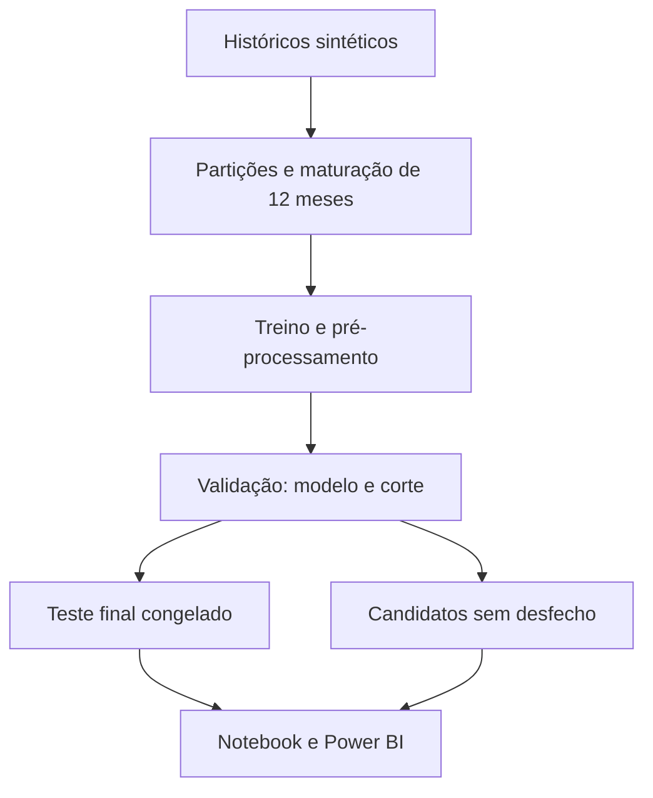

# Metodologia e arquitetura do experimento

## Contrato da previsão

Unidade: uma proposta de aplicativo, observada na data de decisão. Horizonte: 12 meses após o
lançamento hipotético. Alvo binário: `(receita_12m - custo_total_12m) / custo_total_12m >= 0.20`.
`data_desfecho` é a data em que esse rótulo fica disponível. A recomendação de lançamento é separada
do alvo: escolher lançar não é um desfecho histórico a ser aprendido.

O simulador usa um sinal latente de demanda/execução, ruído normal e razão de receita/custo lognormal.
Os pesos são escolhas didáticas explícitas no código `simulate_outcomes`; não vieram de pesquisa de mercado.
A distribuição é estacionária e os apps são independentes. Por isso, o experimento não simula todo o
risco de mudanças de mercado, dependência entre produtos ou histórico de uma mesma empresa.

Custo total = desenvolvimento + 12 × marketing mensal + 12 × R$10.000 de operação hipotética.
O simulador produz receita e ROI e cria ausências de 2% em três variáveis depois de gerar os desfechos.
Os valores econômicos não constituem projeções financeiras de aplicativos reais.

## Diagrama da execução

## Divisão e disponibilidade da informação

| Uso | Avaliações | Quando seus desfechos estão maduros |
| --- | --- | --- |
| Treino | 2020–2021 | Até fim de 2022 |
| Embargo | 2022 | Não usado no ajuste ou avaliação |
| Validação | 2023 | Até fim de 2024 |
| Embargo | 2024 | Não usado no ajuste ou avaliação |
| Teste | 2025 até setembro | Até setembro de 2026 |
| Candidatos | Outubro de 2026 | Desconhecidos |

O corte é por data inteira e as identidades são disjuntas. Um teste verifica que o último desfecho
de cada conjunto antecede a primeira avaliação do seguinte. A disponibilidade é conservadora: o modelo
permanece congelado e não incorpora novos casos entre as datas de avaliação do teste.

## Estimadores

1. **Dummy prior**: probabilidade constante igual à prevalência no treino.
2. **Regressão logística**: imputação por mediana, padronização, imputação categórica e one-hot.
3. **HistGradientBoosting calibrado**: pipeline completo calibrado por sigmoid em três folds
   estratificados internos ao treino, com `ensemble=True`.

Não há busca extensa de hiperparâmetros. Os três candidatos e configurações foram definidos previamente.
O menor Brier na validação escolhe o vencedor; ROC-AUC desempata. O baseline participa e pode vencer.
O teste contém apenas a avaliação final do vencedor, evitando escolher modelo pelo teste.

## Política de decisão

O corte de classificação binária é escolhido entre 0,05 e 0,95, em passos de 0,01, minimizando:
`(2 × falsos positivos + falsos negativos) / n_validacao`.
Empates favorecem o corte maior, uma decisão conservadora explícita. São custos relativos hipotéticos,
não reais monetários, e nenhuma garantia de ótimo fora dessa amostra.

A faixa de revisão é de 0,10 abaixo/acima do corte, limitada a [0,1].
`Lancar`: p >= limite superior; `Adiar`: p < limite inferior; `Validar mais`: demais casos.
Essa faixa não foi otimizada e não é intervalo de confiança individual. A matriz de confusão e as métricas
binárias usam o corte central; não medem o desempenho de uma operação que encaminha casos a humanos.

## Métricas e explicabilidade

- ROC-AUC: ordenação entre classes, sem definir um corte.
- PR-AUC: reportada como **average precision**, não integração trapezoidal.
- Brier e log loss: qualidade probabilística; quanto menor, melhor.
- Precisão/recall/F1, acurácia e FP/FN: dependem do corte central.
- Bootstrap de ROC-AUC: 500 reamostragens do teste, IC percentil de 95%; assume independência e não
  incorpora incerteza de seleção do modelo ou de geração dos dados.
- Importância por permutação: queda de ROC-AUC em oito embaralhamentos da validação por variável.
  O desvio não é intervalo de confiança. Não usar como prova causal.

## Exportação

Os CSVs processados alimentam tanto o notebook quanto o Power BI. O PBIP inclui cópia base64 dos CSVs
no código Power Query: não contém credenciais, cache de usuário ou caminhos absolutos da máquina.
Um parâmetro opcional `PastaDados` substitui o snapshot por CSVs locais. O gerador Power BI escreve
um modelo TMSL `model.bim`, um relatório PBIR e as medidas DAX. As cinco tabelas são independentes,
pois representam granularidades e populações diferentes; não se cria uma relação artificial entre elas.
